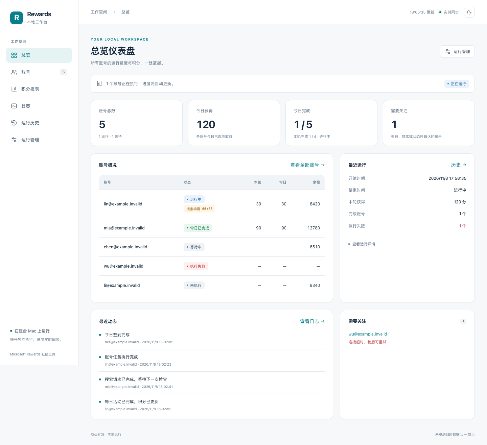

# Rewards macOS

[简体中文](#zh-cn) | [English](#english)

<a id="zh-cn"></a>

**在 macOS 上运行 Microsoft Rewards 自动化，并通过受限的本机 GUI 查看和管理任务。**

基于 `Microsoft-Rewards-Script` 的 `V4-china` v4.3.3，增加 macOS 原生部署、实时监控、持久运行记录和故障恢复。后台沿用原有 TypeScript 执行引擎，界面提供账号、积分、日志与运行管理。无需 Docker。

**适用范围：原生安装、LaunchAgent 定时任务和 GUI 服务管理主要面向 macOS，已在 Apple Silicon 环境验证。GUI 是浏览器中的本机工作台，提供有限的查询与白名单控制；账号配置、首次登录和系统权限仍需在本机完成。**

[](https://nodejs.org/)
[](LICENSE)



截图使用演示数据，仓库不附带个人账号、登录会话或实际积分记录。本项目与 Microsoft 没有隶属或官方合作关系。

## macOS 与受限 GUI 的范围

界面默认由本机监控服务 `127.0.0.1:3000` 提供，再连接本机 Control API `127.0.0.1:3010`。任务实际运行在这台 Mac 上；关闭网页不会停止后台任务。

| 需求           | GUI 提供的能力                                           | 仍需在本机完成的部分                                                                           |
| -------------- | -------------------------------------------------------- | ---------------------------------------------------------------------------------------------- |
| 查看执行情况   | 账号状态、今日与本轮结果、积分趋势、日志、历史和资源摘要 | 缺失观测保持未知，界面不能补回未记录的事实                                                     |
| 运行控制       | 启动全部或已配置的选中账号、优雅停止、强制停止、重启服务 | 控制动作需要本机控制密钥与确认，且只开放预设动作                                               |
| 账号与任务配置 | 显示部分配置和会话摘要                                   | 在 `.env` / `config.json` 中增删账号、修改任务开关、并发和每日时间，再按说明重启或重新注册计划 |
| 登录与会话恢复 | 显示执行错误和会话状态                                   | 在终端执行人工登录，并在浏览器中完成验证码或其他验证；失效会话也需人工处理                     |
| 系统部署与权限 | 显示本机服务与调度信息，提供受限的服务重启               | 安装依赖、注册 LaunchAgent、处理 macOS 权限和电源条件                                          |

GUI 没有完整配置编辑器，也不提供公网远程管理部署。小屏适配只调整页面布局，仓库不提供手机独立运行自动化的方案。Windows 与 Docker 的上游引擎入口继续保留，但本项目的 macOS GUI 运维、`launchd` 调度和资源采集没有据此获得跨平台运行保证；其他平台请参阅[上游文档档案](docs/upstream-v4-china.md)。

## 可以做什么

- **多账号执行**：账号编号可跳号，独立保存桌面/移动会话；支持明确并发上限，按配置错峰启动后并行执行。
- **实时监控**：查看每账号状态、当前步骤、等待时间、任务事件和错误；连接中断与观测缺失会明确提示。
- **积分报表**：在同一入口查看当前余额、日历日收益及日期区间统计，未知值保持为空，不补成零。
- **运行管理**：按账号选择启动、优雅停止、强制停止和重启服务；同时查看本机资源与会话摘要。
- **持久恢复**：API 和监控分别保存运行身份与事件，处理重启、日志延迟和重复请求；中断恢复保留未完成账号集合。
- **原有任务能力**：每日集、签到、阅读、促销、桌面/移动搜索及通知等仍由原引擎执行，是否可用取决于账号、地区、配置和服务端返回。

## 快速开始

主要运行环境是 **macOS Apple Silicon**，需要 Homebrew、Node.js 24+ 和可用的 Chromium 下载网络。安装脚本默认使用 `/opt/homebrew/bin/node`；Intel Mac 的 Homebrew 路径通常不同，本仓库没有将其作为已验证的一键安装环境。

### 1. 获取并安装

从本仓库的 **Code → Download ZIP** 下载并解压，在终端进入项目根目录：

```bash
brew install node
bash install.command
```

安装脚本会安装依赖与 Patchright Chromium、构建引擎和界面、生成缺失的 `config.json` / `.env`，并注册本地 LaunchAgents。已有配置会保留。安装同时注册每日调度与补跑守卫；如果已有账号配置，后续定时触发会执行任务。

### 2. 添加本地账号

编辑项目根目录的 `.env`。安装器会生成 API 设置，监控首次启动时生成本机控制密钥；保留已有设置，在文件后添加账号：

```dotenv
ACCOUNT_1_EMAIL=you@example.com
# 使用密码登录时填写；无密码账号可不设置。
# ACCOUNT_1_PASSWORD=replace_locally
ACCOUNT_1_GEO_LOCALE=CN
ACCOUNT_1_LANG_CODE=zh-CN

# 更多账号使用不同的正整数编号，允许跳号。
# ACCOUNT_3_EMAIL=another@example.com
# ACCOUNT_3_GEO_LOCALE=auto
# ACCOUNT_3_LANG_CODE=en
```

完整字段和每账号代理见 [`env.example`](env.example)。行为开关、浏览器设置和通知配置见 [`config.example.json`](config.example.json)。运行中的 API 在启动时读取账号环境；改完 `.env` 后重启服务使其生效。

### 3. 首次登录并打开界面

在本机终端执行人工登录，按浏览器提示完成验证：

```bash
npm run manual-login -- you@example.com --platform both
bash restart.command
```

打开 **[http://127.0.0.1:3000](http://127.0.0.1:3000)**。在“运行管理”中选择账号、确认后启动一轮。人工登录和任务执行会访问外部账号；上面的安装和检查命令不能证明某个账号已登录或已完成任务。

日常再次打开服务与界面可运行 `bash start.command`，无需重复安装。详细操作见[运行与恢复说明](docs/operations.md)。

## 界面导航

| 入口     | 用途                                                 |
| -------- | ---------------------------------------------------- |
| 总览     | 运行概况、账号进展、积分摘要与需要处理的异常         |
| 账号     | 多账号列表、筛选和账号详情；详情日志持续更新         |
| 积分报表 | 当前余额、每日收益与区间统计，合并原先重复的积分入口 |
| 日志     | 实时日志、级别和账号筛选                             |
| 历史     | 运行批次、账号结果与退出信息                         |
| 运行管理 | 启停与服务管理，以及本机资源、会话和调度信息         |

界面支持浅色/深色主题和小屏布局。监控查询不会自行启动任务；看门狗和每日守卫属于单独记录的自动恢复/调度路径。

## 本机采用的定时计划与并发

本项目维护者当前在 Mac 上使用以下计划。公开仓库提供源码和配置示例；下载仓库后，需要在自己的机器上添加账号、完成登录并注册计划，不会继承维护者的账号或运行状态。

| 项目         | 当前使用的设置                                                       |
| ------------ | -------------------------------------------------------------------- |
| 日界与时区   | `Asia/Shanghai`，按上海自然日统计和核对账号结果                      |
| 每日开始时间 | **00:00 开始调度**                                                   |
| 并发上限     | **最多 3 个账号并行**，当前三个账号各分配一个 worker                 |
| 启动间隔     | 账号之间保留 **20–40 秒错峰启动**；拉起后任务可以重叠执行            |
| 漏跑检查     | 每 **600 秒（10 分钟）**检查一次，只为缺少当日成功终态的账号安排补跑 |

在本机 `.env` 中设置：

```dotenv
REWARDS_CONCURRENCY=3
REWARDS_DAILY_HOUR=0
REWARDS_DAILY_MINUTE=0
```

在现有 `config.json` 中确认 `accountDelay` 字段，保留其余配置：

```json
{
    "accountDelay": { "min": "20s", "max": "40s" }
}
```

`REWARDS_CONCURRENCY=3` 是并发上限，不要求三个浏览器在同一瞬间启动。账号多于并发数时均衡分到 worker，块内继续顺序执行并保留间隔。未配置明确并发数时，调度器按内存预算估算；旧 `REWARDS_FORCE_CLUSTERS` 仍兼容，优先级低于 `REWARDS_CONCURRENCY`。实际可承载的浏览器和账号数量取决于硬件与任务状态。

修改每日时间后，只重新注册每日代理：

```bash
bash scripts/macos/install-launchd.sh --only local.rewards.daily
```

安装器注册的 macOS 用户级任务如下：

| LaunchAgent                | 触发或运行方式                   | 职责                                             |
| -------------------------- | -------------------------------- | ------------------------------------------------ |
| `local.rewards.api`        | 加载时启动，异常退出后保活       | 提供本机 Control API，默认端口 3010              |
| `local.rewards.monitor`    | 加载时启动，异常退出后保活       | 提供 GUI、状态聚合与受限控制，默认端口 3000      |
| `local.rewards.daily`      | 每日 00:00，不在注册时立即跑一轮 | 启动每日调度，按配置错峰拉起账号                 |
| `local.rewards.dailyguard` | 加载时检查，之后每 600 秒检查    | 核对逐账号当日成功结果并补漏；已经成功的账号跳过 |
| `local.rewards.keepawake`  | 加载时运行 `caffeinate -s`       | 仅交流电下保持系统唤醒，允许屏幕熄灭             |

`launchd` 的日历触发按 **Mac 系统时区**计算，精确上海零点触发需把系统时区保持为上海；单独设置进程 `TZ` 不会改变系统日历触发时刻。零点执行还需要 Mac 开机并处于用户登录会话。睡眠等原因错过后，恢复可运行时由补跑守卫检查。关闭 GUI 网页不会暂停这些任务，`stop.command` 也不会注销每日代理；暂停自动计划的方法见[运行与恢复说明](docs/operations.md)。

账号列表区分本轮进度与今日已确认结果：只跑一个账号时，其余当天已完成的账号仍显示“今日已完成”，不会计入这一轮的完成数。积分趋势按连续上海自然日显示，纵轴随当前区间的数据变化自动重算；缺失观测为 `—`，明确零收益为 `0`。跨日批次按结束日归档，不推算实际逐日到账。

移动/桌面额度按服务端返回独立计算。某次缺少移动额度时会跳过该项，不能由此推定全部地区或账号均无该能力。实验 API 搜索与 Edge 浏览默认为关闭，详见配置示例。

## 架构与数据

```text
React 界面 → 本机监控服务（3000）→ Control API（3010）→ 原任务引擎
                 │                       │                 │
          运行事件 / 积分投影          运行登记与日志       账号会话
```

默认服务只监听本机回环地址。配置、会话、日志和运行数据留在本机：

| 位置                          | 内容                               |
| ----------------------------- | ---------------------------------- |
| `.env` / `config.json`        | 本地账号、API 和任务配置           |
| `sessions/` 或 `sessionPath`  | SQLite 账号/平台会话与指纹         |
| `.control-api/runtime.sqlite` | 运行身份、日志、历史与幂等请求     |
| `monitor/data/`               | 监控事件、台账、恢复计划与资源采样 |
| `logs/`                       | 引擎与本地服务日志                 |

公开发布只包含源码、示例配置、测试和文档。请勿将个人配置、会话、运行记录或备份加入公开提交。

架构和恢复边界见[架构说明](docs/architecture.md)；当前 Control API 扩展见[控制接口说明](docs/control-api.md)。

## 开发与检查

```bash
npm ci --ignore-scripts
npm --prefix monitor/web ci --ignore-scripts
npm run check
npm run build
npm run install:browser
npm run test:web
```

- `npm run check`：类型、ESLint、离线测试和格式检查。
- `npm run test:web`：构建界面并运行隔离浏览器测试，使用合成账号与假执行器。
- UI 开发：`npm --prefix monitor/web run dev`，通过 Vite 代理连接本机监控服务。
- 原 API：`npm run api`；监控服务：`npm --prefix monitor start`。请避免与已启动的 LaunchAgent 争用同一端口。

测试覆盖会话锁竞争、worker 生命周期、API 崩溃接管、幂等启停、事件重放、积分语义与页面同步。**离线或界面测试通过不代表真实登录、积分到账、外部限流或所有浏览器并发数量通过。** CI 定义覆盖 Node.js 24/26 和 Linux/macOS；实际结果以对应 Actions 运行记录为准。

## 贡献者与 AI 协作

- **[TakeRay1ee](https://github.com/TakeRay1ee)**：项目维护、需求与运行方案确定、本机部署和使用反馈。
- **[Codex](https://openai.com/codex/)（OpenAI AI 编程助手）**：在维护者指示下，协助代码审查与修复、macOS 调度和状态同步、GUI 与趋势图优化、回归测试及文档整理。

Codex 以 AI 辅助开发工具的身份参与本项目。上游作者、代码来源与许可说明保留如下。

## 使用边界与来源

Microsoft Rewards 对自动化搜索及计分行为有限制，账号可能受到限制；请阅读 [Microsoft 服务协议](https://www.microsoft.com/en-US/servicesagreement)及[Rewards 官方帮助](https://support.microsoft.com/en-us/accounts-billing/rewards/getting-the-most-out-of-microsoft-rewards)。本项目不绕过安全验证、风控提示或账号限制，也不保证积分有效或账号安全。

本地扩展版从 [chiihero/Microsoft-Rewards-Script 的 V4-china](https://github.com/chiihero/Microsoft-Rewards-Script/tree/1763135896905d1c08f65d058cdf10860a3b591e) 导入，基准为 **v4.3.3 / `1763135`**；该分支继承 [TheNetsky/Microsoft-Rewards-Script v4](https://github.com/TheNetsky/Microsoft-Rewards-Script/tree/v4)。本地扩展版本不代表上游发布版本。

采用 **[GPL-3.0-or-later](LICENSE)**，保留 Netsky、chiihero 及其他上游贡献者署名。第三方来源见[署名说明](THIRD_PARTY_NOTICES.md)，原分支文档快照见[上游档案](docs/upstream-v4-china.md)，本地版本变化见[CHANGELOG](CHANGELOG.md)。

## English

[简体中文](#zh-cn) | **English**

**Run Microsoft Rewards automation on macOS and observe or manage tasks through a limited local GUI.**

Based on `Microsoft-Rewards-Script` **V4-china v4.3.3**, this extension adds native macOS deployment, live monitoring, durable run history, and recovery. The original TypeScript engine still performs account activities. Docker is not required for the native macOS setup.

**Platform scope:** native installation, LaunchAgent scheduling, and GUI service management primarily target **macOS** and have been verified on **Apple Silicon**. The GUI is a browser-based local workbench with limited queries and predefined controls. Account configuration, initial login, and system permissions still require local setup.


Screenshots use synthetic data. The public repository includes no personal accounts, login sessions, or actual points records. This project is not affiliated with or endorsed by Microsoft.

### macOS and the limited GUI

The GUI is served by the local monitor at `127.0.0.1:3000`, which connects to the local Control API at `127.0.0.1:3010`. Tasks execute on that Mac. Closing the browser page does not stop background tasks.

| Need                         | Available in the GUI                                                                                  | What still requires local action                                                                                                                                  |
| ---------------------------- | ----------------------------------------------------------------------------------------------------- | ----------------------------------------------------------------------------------------------------------------------------------------------------------------- |
| Observe execution            | Account status, today's and current-run results, points trends, logs, history, and resource summaries | Missing observations remain unknown; the GUI cannot reconstruct facts that were never recorded                                                                    |
| Control runs                 | Start all or selected configured accounts, stop gracefully, force-stop, and restart services          | Actions require a local control key and confirmation; only predefined actions are exposed                                                                         |
| Configure accounts and tasks | View selected configuration and session summaries                                                     | Edit `.env` / `config.json` to add or remove accounts, change task switches, concurrency, or schedule; restart services or re-register the schedule as instructed |
| Login and session recovery   | View errors and session status                                                                        | Run manual login in a terminal and complete verification in the browser; expired sessions may require manual repair                                               |
| Deployment and permissions   | View local service/scheduling information and request a limited service restart                       | Install dependencies, register LaunchAgents, and handle macOS permissions and power conditions                                                                    |

The GUI is not a complete configuration editor or a public remote-management deployment. Responsive layouts do not make a phone an independent automation host. Upstream Windows and Docker engine entry points are retained, but macOS GUI operations, `launchd` scheduling, and resource collection are not claimed to work across platforms. See the [upstream documentation archive](docs/upstream-v4-china.md) for upstream platform options.

### Features

- **Multiple accounts:** non-contiguous account numbers, separate desktop/mobile sessions, an explicit concurrency limit, and staggered worker starts.
- **Live monitoring:** per-account status, current steps, waits, activity events, and errors, with visible connection and observation gaps.
- **Points reports:** balances, calendar-day earnings, and date-range summaries. Unknown values remain empty instead of being converted to zero.
- **Run management:** select accounts, start or stop runs, restart services, and inspect local resources and session summaries.
- **Durable recovery:** the API and monitor retain run identities and events, handle restarts, delayed logs, and duplicate requests, and preserve unfinished account selections.
- **Original activities:** daily sets, check-in, reading, promotions, desktop/mobile searches, and notifications continue to use the original engine. Availability depends on the account, region, configuration, and service responses.

### Quick start

The verified native environment is **macOS on Apple Silicon**, with Homebrew, **Node.js 24+**, and network access to download Chromium. The installer defaults to `/opt/homebrew/bin/node`. Intel Macs commonly use a different Homebrew path; one-command installation on Intel has not been verified.

#### 1. Download and install

Download and extract **Code → Download ZIP**, or clone the repository:

```bash
git clone https://github.com/TakeRay1ee/rewards-macos.git
cd rewards-macos
```

From the project root, install:

```bash
brew install node
bash install.command
```

The installer installs dependencies and Patchright Chromium, builds the engine and GUI, creates missing `config.json` / `.env` files, and registers local LaunchAgents. Existing configuration is preserved. Installation also registers the daily schedule and catch-up guard; configured accounts can therefore run on subsequent scheduled triggers.

#### 2. Add local accounts

Edit `.env` in the project root. The installer creates API settings, and the monitor creates its local control key on first startup. Keep the existing settings and append accounts:

```dotenv
ACCOUNT_1_EMAIL=you@example.com
# Set a password only when using password-based login.
# ACCOUNT_1_PASSWORD=replace_locally
ACCOUNT_1_GEO_LOCALE=CN
ACCOUNT_1_LANG_CODE=zh-CN

# Use distinct positive numbers for additional accounts; gaps are allowed.
# ACCOUNT_3_EMAIL=another@example.com
# ACCOUNT_3_GEO_LOCALE=auto
# ACCOUNT_3_LANG_CODE=en
```

See [`env.example`](env.example) for available fields and per-account proxy settings, and [`config.example.json`](config.example.json) for activity switches, browser options, and notifications. The API reads account environment variables at startup; restart services after editing `.env`.

#### 3. Sign in and open the GUI

Run manual login in a local terminal and complete the browser verification:

```bash
npm run manual-login -- you@example.com --platform both
bash restart.command
```

Open **[http://127.0.0.1:3000](http://127.0.0.1:3000)**. In the Run management page (`运行管理`), select accounts and confirm before starting a run. Manual login and real task execution access external accounts; successful installation or checks alone do not establish that an account is signed in or that its tasks have completed.

For later use, run `bash start.command` without reinstalling. See [Operations and recovery (Chinese)](docs/operations.md) for details.

### Navigation

| GUI entry                 | Purpose                                                               |
| ------------------------- | --------------------------------------------------------------------- |
| 总览 — Overview           | Run summary, account progress, points, and issues requiring attention |
| 账号 — Accounts           | Account list, filters, and account details with live logs             |
| 积分报表 — Points reports | Balances, daily earnings, and date-range statistics                   |
| 日志 — Logs               | Live logs with severity and account filters                           |
| 运行历史 — Run history    | Batches, account results, and exit information                        |
| 运行管理 — Run management | Run/service controls, resources, sessions, and scheduling information |

The GUI supports light/dark themes and narrow screens. Monitoring queries do not start tasks themselves. The watchdog and daily guard are separate, recorded recovery/scheduling mechanisms.

### The maintainer's schedule and concurrency

The maintainer currently uses the following plan on a Mac. The repository distributes source code and examples; users must configure their own accounts, sign in, and register the schedule. The maintainer's accounts and runtime state are not distributed.

| Setting                      | Current plan                                                                                              |
| ---------------------------- | --------------------------------------------------------------------------------------------------------- |
| Time zone and daily boundary | `Asia/Shanghai`; account results are checked by Shanghai calendar day                                     |
| Daily trigger                | **Begin scheduling at 00:00**                                                                             |
| Concurrency                  | **Up to 3 accounts in parallel**; the current three accounts each receive a worker                        |
| Startup spacing              | **20–40 seconds between account starts**; tasks can overlap after workers are started                     |
| Catch-up checks              | Every **600 seconds (10 minutes)**; retry only accounts without a confirmed successful result for the day |

Set these values in the local `.env`:

```dotenv
REWARDS_CONCURRENCY=3
REWARDS_DAILY_HOUR=0
REWARDS_DAILY_MINUTE=0
```

Check `accountDelay` in the existing `config.json`, preserving its other settings:

```json
{
    "accountDelay": { "min": "20s", "max": "40s" }
}
```

`REWARDS_CONCURRENCY=3` is a concurrency limit, not an instruction to launch three browsers at the same instant. Additional accounts are balanced across workers and execute sequentially within each worker, retaining their delays. Without an explicit concurrency value, the scheduler estimates capacity from memory. The legacy `REWARDS_FORCE_CLUSTERS` option remains supported but has lower priority than `REWARDS_CONCURRENCY`. Actual capacity depends on hardware and task behavior.

After changing the daily trigger time, re-register only the daily agent:

```bash
bash scripts/macos/install-launchd.sh --only local.rewards.daily
```

The installer registers these macOS user LaunchAgents:

| LaunchAgent                | Trigger or lifecycle                                               | Responsibility                                                                           |
| -------------------------- | ------------------------------------------------------------------ | ---------------------------------------------------------------------------------------- |
| `local.rewards.api`        | Starts when loaded; kept alive after an unsuccessful exit          | Local Control API, port 3010 by default                                                  |
| `local.rewards.monitor`    | Starts when loaded; kept alive after an unsuccessful exit          | GUI, aggregated state, and limited controls, port 3000 by default                        |
| `local.rewards.daily`      | Daily at 00:00; registration does not immediately start a task run | Start daily scheduling with staggered account workers                                    |
| `local.rewards.dailyguard` | Checks when loaded, then every 600 seconds                         | Catch up accounts missing a successful result; skip accounts already successful that day |
| `local.rewards.keepawake`  | Runs `caffeinate -s` when loaded                                   | Prevent system sleep on AC power while allowing the display to sleep                     |

`launchd` calendar triggers use the **Mac's system time zone**. Keep that zone set to Shanghai for an exact Shanghai midnight trigger; setting the process `TZ` alone does not move the system calendar trigger. The Mac must be on and the user logged in. If sleep or another interruption causes a missed trigger, the catch-up guard checks again when execution becomes possible. Closing the GUI does not pause these agents, and `stop.command` does not unregister the daily agent. See [Operations and recovery (Chinese)](docs/operations.md) for pausing the automatic schedule.

The account list separates today's confirmed outcomes from current-run progress: running only one account does not erase the other accounts' completion for today or count them as completed in that single-account run. Trends use consecutive Shanghai calendar dates, and the vertical axis recalculates with the selected range's data. Missing observations appear as `—`; an observed zero remains `0`. Earnings are archived by batch end date; cross-day batches are not split into estimated daily credits.

Mobile and desktop limits are determined independently from service responses. Missing mobile limits in one response do not establish that mobile activity is unavailable for every account or region. Experimental API searches and Edge browsing are disabled by default; see the configuration example.

### Architecture and local data

```text
React GUI → Local monitor (3000) → Control API (3010) → Original task engine
                    │                     │                    │
           Events / points views     Run registry / logs    Account sessions
```

Services bind to loopback by default. Configuration, sessions, logs, and runtime records stay local:

| Location                      | Contents                                                     |
| ----------------------------- | ------------------------------------------------------------ |
| `.env` / `config.json`        | Local accounts, API settings, and task configuration         |
| `sessions/` or `sessionPath`  | SQLite account/platform sessions and fingerprints            |
| `.control-api/runtime.sqlite` | Run identities, logs, history, and idempotent requests       |
| `monitor/data/`               | Monitor events, ledger, recovery plans, and resource samples |
| `logs/`                       | Engine and local service logs                                |

The public distribution contains source, examples, tests, and documentation. Do not add personal configuration, sessions, runtime records, or backups to public commits.

Further documentation: [Architecture (Chinese)](docs/architecture.md) and [Control API extensions (Chinese)](docs/control-api.md).

### Development and checks

```bash
npm ci --ignore-scripts
npm --prefix monitor/web ci --ignore-scripts
npm run check
npm run build
npm run install:browser
npm run test:web
```

- `npm run check`: type checking, ESLint, offline tests, and formatting checks.
- `npm run test:web`: build the GUI and run isolated browser tests with synthetic accounts and a fake executor.
- GUI development: `npm --prefix monitor/web run dev`, using Vite's proxy to the local monitor.
- Control API: `npm run api`; monitor: `npm --prefix monitor start`. Avoid port conflicts with already loaded LaunchAgents.

Tests cover session-lock contention, worker lifecycle, API crash recovery, idempotent controls, event replay, points semantics, and page updates. **Passing offline or GUI tests does not prove real Microsoft login, points crediting, external rate-limit behavior, or stability at every browser concurrency level.** The CI definition covers Node.js 24/26 on Linux/macOS; consult the corresponding Actions run for actual results.

### Contributors and AI collaboration

- **[TakeRay1ee](https://github.com/TakeRay1ee)**: project maintenance, requirements and runtime decisions, local deployment, and usage feedback.
- **[Codex](https://openai.com/codex/) (OpenAI AI coding assistant)**: assisted under the maintainer's direction with code review and repairs, macOS scheduling and state synchronization, GUI and trend improvements, regression tests, and documentation.

Codex participated as an AI-assisted development tool. Upstream authorship, provenance, and license notices remain preserved below.

### Usage boundaries and provenance

Microsoft Rewards restricts automated search and points-earning behavior, and accounts may be restricted. Read the [Microsoft Services Agreement](https://www.microsoft.com/en-US/servicesagreement) and [official Rewards help](https://support.microsoft.com/en-us/accounts-billing/rewards/getting-the-most-out-of-microsoft-rewards). This project does not bypass verification, risk-control prompts, or account restrictions, and does not guarantee valid points or account safety.

This local extension was imported from [chiihero/Microsoft-Rewards-Script, V4-china](https://github.com/chiihero/Microsoft-Rewards-Script/tree/1763135896905d1c08f65d058cdf10860a3b591e), with baseline **v4.3.3 / `1763135`**. That branch inherits [TheNetsky/Microsoft-Rewards-Script v4](https://github.com/TheNetsky/Microsoft-Rewards-Script/tree/v4). Local extension versions do not represent upstream releases.

Licensed under **[GPL-3.0-or-later](LICENSE)**. Netsky, chiihero, and other upstream contributors retain their attribution. See [Third-party notices (Chinese)](THIRD_PARTY_NOTICES.md), the [upstream documentation archive](docs/upstream-v4-china.md), and the [local changelog (Chinese)](CHANGELOG.md).
