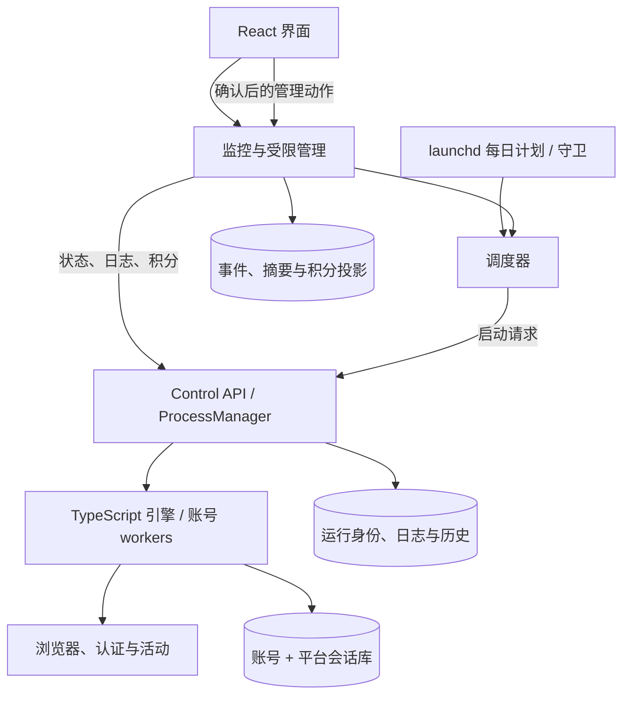

# 架构与事实来源

项目保留一个活动执行引擎。界面和调度扩展负责观察、管理、持久化与恢复，不重复实现登录和 Rewards 活动。

## 四个 module

| Module      | Interface 的责任                             | 持久事实                               |
| ----------- | -------------------------------------------- | -------------------------------------- |
| 活动引擎    | 账号与任务配置进入，活动结果与结构化日志输出 | 账号/平台会话、账号日期完成记录        |
| Control API | 稳定运行身份、幂等启停、进程观测和持久历史   | `.control-api/runtime.sqlite`          |
| 调度与恢复  | 资源计划、账号选择、调度排他与未完成项恢复   | 调度锁、请求键、恢复计划与回执         |
| 监控与报表  | 合并可信日志事实，公开快照与日期区间查询     | 事件 journal、metadata、余额与积分投影 |

界面跨越这些公开 interface 获取事实。运行状态、积分和账号身份不由页面静态数据伪造。

## 身份与结果

- **账号身份**使用完整邮箱；配置槽位只是位置，不要求连续编号。旧日志前缀不能唯一对应账号时保持未知。
- **运行身份**使用稳定 `runId`，账号选择与每条日志关联同一批次。开始、接收命令和成功结束分别表示不同事实。
- **启动请求**可以携带持久 `requestId`，重放同一请求返回原运行，避免再次派生任务。
- **停止请求**可以携带 `expectedRunId`，迟到的请求不能停止后来启动的另一轮。
- **积分观测**区分缺失与真实零分；读取余额本身不能证明该次收益是零。

## 一致性与恢复

监控摘要是事件的投影，不能在重启时仅凭有限 API 尾部覆盖更完整的历史。投影保留日志水位：journal 中晚于摘要的事件补一次，API 尾部中已经提交过的事实不再累计。

兼容旧版以开始时间命名的批次目录时，先核对开始时间与运行身份，再采用稳定 `runId`。若两个目录已并存，则按账号摘要的可靠水位恢复并去重事件，原始旧目录归档在稳定目录下；不同账号的较新摘要不会被当成同一条全局进度。身份冲突或水位无法核实时保留原记录，不自动猜测合并。

正常子进程收尾会等待输出管道关闭再归档。观察 API 实例尊重仍存活的原 owner 的收尾权，避免先到的未知退出覆盖真实结果。

进程控制恢复与实时观测恢复是两个能力。身份匹配的存活任务可以被接管，但旧 stdout 不能重新接回；此时界面显示观测降级，自动停滞判断暂停。

## 并行与隔离

引擎按 `clusters` 将账号均衡分到恰好 `min(账号数, clusters)` 个非空块，块内串行、worker 之间并行。例如四个账号、三个 clusters 分为 2/1/1，三个账号、三个 clusters 为每人一个 worker。worker 按账号间隔错峰启动，启动后允许重叠执行；不会因向上取整分块而少开一个 worker。

调度器的显式 `REWARDS_CONCURRENCY` 先于旧强制配置与资源估算；设置为 3 后最多三 worker，内存数据继续供观测而不静默改变这个选择。状态、报表和每日守卫共用 `calendar.mjs` 的上海自然日，避免运行进程时区不同导致零点和收益日期错位。

会话数据库以完整账号和平台为主键。初始化采用有界锁等待与重试；成功连接在完整初始化后才发布。API 和调度锁同样使用短 SQLite 事务与进程身份，避免控制器重启后重复启动。

这些不变量有临时 SQLite、多进程与纯状态回归验证；测试规模不是对真实 Chromium 并发容量的承诺。

## 测试 seam

测试跨越公开 seam 验证行为：SessionStore 的读写、Control API HTTP 与假 worker、RunTracker 的状态/日志到持久结果、TaskAttempt 到账号最终结果，以及浏览器页面到真实副本服务。

通过减少重复的状态推断获得 locality：身份、退出、未知值和完成规则在拥有事实的 module 内处理。界面改版也合并积分与运行资源入口，减少同一数据在多个页面各自解释的成本。
